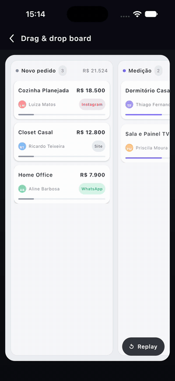
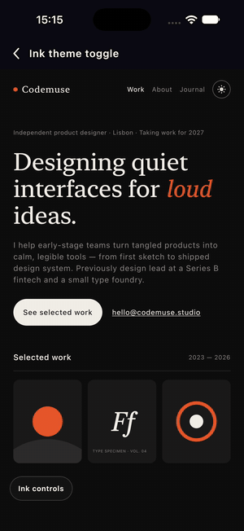
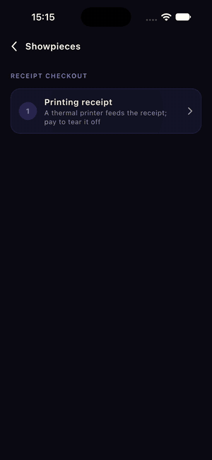
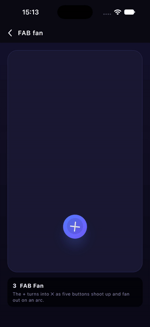
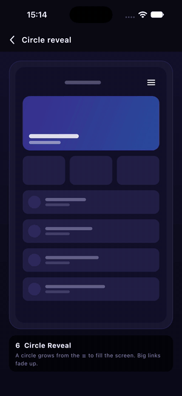
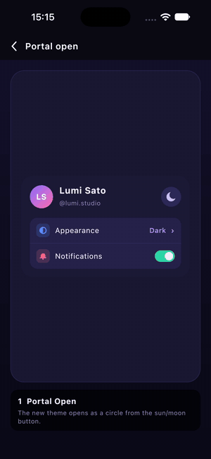
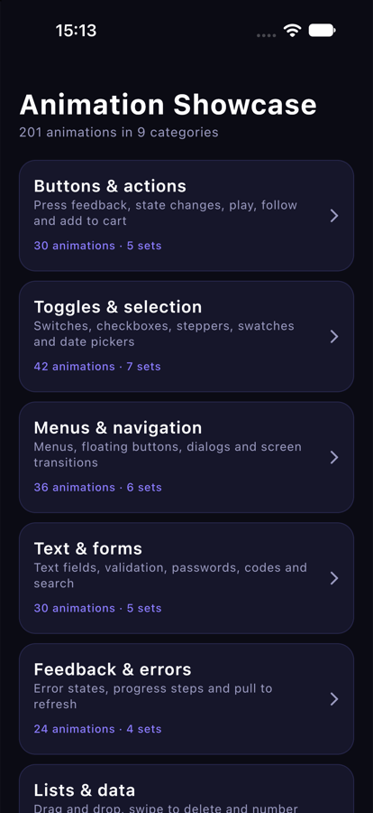
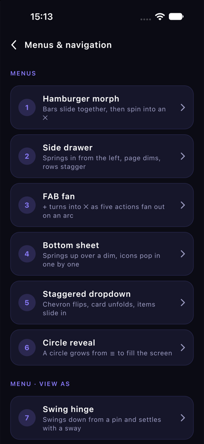
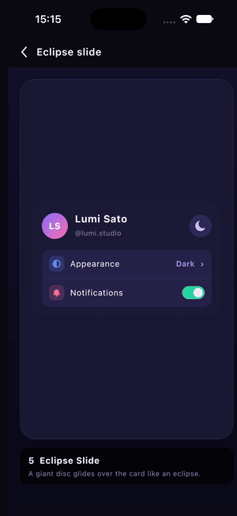

<p align="center">
  
</p>

<h1 align="center">UiTemplates</h1>

<p align="center">
  <b>201 polished UI animations for Compose Multiplatform, ready to copy into your app.</b><br/>
  Buttons, switches, menus, forms, errors, likes, theme switches and more, running natively on Android and iOS.
</p>

<p align="center">
  
  
  
  
  
</p>

---

## Showcase

<table>
  <tr>
    <td align="center" width="33%"><br/><sub><b>Drag & drop board</b><br/>lift, tilt, column glow, confetti</sub></td>
    <td align="center" width="33%"><br/><sub><b>Ink theme toggle</b><br/>dark ↔ light spreads like ink in water</sub></td>
    <td align="center" width="33%"><br/><sub><b>Receipt checkout</b><br/>prints line by line, tears off on pay</sub></td>
  </tr>
  <tr>
    <td align="center"><br/><sub><b>FAB fan</b><br/>actions fan out on a spring arc</sub></td>
    <td align="center"><br/><sub><b>Circle reveal</b><br/>a circle grows from ☰ to full screen</sub></td>
    <td align="center"><br/><sub><b>Portal open</b><br/>the new theme opens from the toggle</sub></td>
  </tr>
  <tr>
    <td align="center"><br/><sub><b>Home</b><br/>9 categories</sub></td>
    <td align="center"><br/><sub><b>Category</b><br/>sets with one button per animation</sub></td>
    <td align="center"><br/><sub><b>Eclipse slide</b><br/>a giant disc glides over the card</sub></td>
  </tr>
</table>

Most animations play once by themselves when you open them, and all of them are fully interactive: tap,
drag, long-press, type and swipe as you would in a real app.

## What's inside

| Category | Animations | Examples |
|---|---:|---|
| Buttons & actions | 30 | liquid rise, barrel roll, pixel scatter, hold to confirm, paper plane, add to cart |
| Toggles & selection | 42 | liquid toggle, day & night, pull-cord lamp, gooey radio, steppers, colour and date pickers |
| Menus & navigation | 36 | hamburger morph, side drawer, gooey menu, command palette, dialogs, screen transitions |
| Text & forms | 30 | floating label, live validation, password strength, verification codes, search |
| Feedback & errors | 24 | shake input, glitch, 404 magnifier, progress steps, pull to refresh |
| Lists & data | 13 | drag-and-drop board, swipe to delete, odometer and split-flap counters |
| Likes & reactions | 12 | heart burst, double-tap heart, reaction picker, heartbeat |
| Theme & backgrounds | 13 | ink and dark-mode theme reveals, mesh, aurora, spotlight backgrounds |
| Showpieces | 1 | receipt checkout |

The full list, with a one-line description of every animation, is in **[CATALOG.md](CATALOG.md)**.

## Run the showcase

Requirements: JDK 17+ (Gradle provisions the JDK it runs on), the Android SDK, and Xcode for iOS.

```bash
git clone https://github.com/akhundzade/UiTemplates.git
cd UiTemplates
```

**Android** (device or emulator connected):

```bash
./gradlew :androidApp:installDebug
```

**iOS:** open `iosApp/iosApp.xcodeproj` in Xcode, pick a simulator or device, and run.

Browse home → category → set, then tap an animation to play it.

## Use an animation in your app

Each animation is plain Compose code (`androidx.compose.*` APIs, no third-party animation libraries), so it
drops into Compose Multiplatform **and** Android-only Jetpack Compose projects.

1. **Find it.** Search [CATALOG.md](CATALOG.md) by component ("switch", "dialog") or use its **Motion index**
   ("spring", "squash", "flip/3D", "ripple", "liquid", "particles", "shake"...).
2. **Copy it.** Each entry has a **Copy** line listing the exact file and declarations that one animation
   needs, for example:

   > **Liquid toggle** (`switch1-liquid`): Knob stretches like a liquid drop as it slides, then squishes at the edge.
   > Copy `LiquidToggleDemo.kt`; from `SwitchStyle.kt` only `KnobInset`, `SwitchColors`, `TrackHeight`, `TrackWidth`, `drawTrack`; from `demos/menus/MenuStyle.kt` only `MenuColors`. Strip `CheckboxStage` (showcase frame).

3. **Strip the showcase wrapper** named on the **Strip** line (the numbered title card, the autoplay script and
   the Replay pill), keeping the content inside it.
4. **Hoist the state, restyle, run.** Pass the value in from your screen, swap in your theme colours and keep
   the timings and springs; they are what make the motion look right.

The detailed porting guide, including pitfalls and how to wire state, is in **[AGENTS.md](AGENTS.md)**.

### With an AI coding agent

The repo is written to be used by agents such as Claude Code. Point yours at it, for example in your global
`CLAUDE.md` or `AGENTS.md`:

```markdown
When I ask for a UI animation, first check my library at <path-to>/UiTemplates: read its AGENTS.md,
search CATALOG.md, and port the closest match instead of writing one from scratch.
```

Then ask in plain words: *"a switch whose knob stretches like a blob"* or *"make the code field shake red on a
wrong code"*. The agent finds the entry, copies the listed declarations and strips the showcase parts.

## Project structure

```
shared/src/commonMain/kotlin/com/azersun/uitemplates/
├── showcase/          the browsable app: categories, sets, navigation
├── demos/<set>/       one package per set
│   ├── <Name>Demo.kt  one animation
│   ├── *Style.kt      shared scene, palette and helpers for the set
│   └── *Demos.kt      registers the set in the showcase
└── common/            shared helpers (confetti, count-up)
androidApp/            Android entry point
iosApp/                iOS entry point (Xcode project)
tools/
├── catalog.py         regenerates CATALOG.md from the code
└── app_icon.py        draws the app icon for both platforms
```

## Add your own animation

1. Create `demos/<set>/` with a `*Style.kt`, one `<Name>Demo.kt` per animation and a `*Demos.kt` exposing a
   `DemoGroup`.
2. Register the group in a category in `showcase/Demos.kt`.
3. Regenerate the catalog: `python3 tools/catalog.py`.

[AGENTS.md](AGENTS.md) describes the conventions and the verification workflow used for every animation here.

## Credits

The animations in this repository are independent Compose recreations of UI animation designs shared as
Instagram reels. No code or assets were taken from the originals: each animation was studied frame by frame
and rebuilt from scratch. The design credit belongs to their creators:

| Creator | Animations recreated |
|---|---|
| **[UI × motion_prompts](https://www.instagram.com/ui_motion_prompts/)** (@ui_motion_prompts) | The six-variant sets: menus, View-as menus, minimal menus, dark mode toggle, backgrounds, steppers, input errors, verification codes, password strength, swipe to delete, add to cart, number counters, pull to refresh, date picker, dialogs, follow button, colour picker, play button, button state changes, progress steps, floating button, screen transitions, text fields, likes, search, checkboxes, buttons, switches and error states |
| **[Nuvio](https://www.instagram.com/nuvio.on/)** (@nuvio.on) | Drag & drop board (from "Furniture CRM V2") |
| **[Codemure](https://www.instagram.com/codemure.official/)** (@codemure.official) | Ink theme toggle |
| **[Code with Ulvi](https://www.instagram.com/codewithulvi/)** (@codewithulvi) | Receipt checkout |

If you created one of these designs and would like the credit changed or an animation removed, please
[open an issue](https://github.com/akhundzade/UiTemplates/issues).
